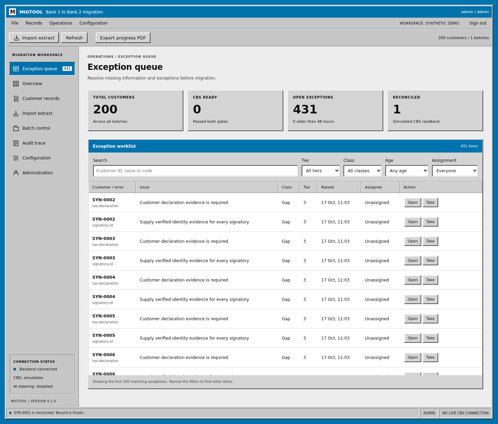

# MIGTOOL

A configuration-driven customer migration workspace with a Windows 95 style interface, ANZ blue title bars, white and black text, and no animations.

Built from an empty repository against the supplied v1.0 migration specification. This is a runnable implementation with a synthetic domain pack. The original application, real extracts, official AAF template, historical golden files and live bank interfaces were not present in the repository.



## Run the synthetic demo

Requires Node.js 24 LTS and npm. Works on Windows, macOS and Linux.

```sh
npm ci
npm run demo
```

Open http://127.0.0.1:5173.

| Role          | Username | Demo password      |
| ------------- | -------- | ------------------ |
| Administrator | admin    | demo-admin-2026    |
| Operator      | operator | demo-operator-2026 |
| Reviewer      | reviewer | demo-reviewer-2026 |

Demo accounts are created only in explicit demo mode. The demo binds to loopback and uses `var/demo.sqlite`, separate from the normal workspace. Do not use these credentials for a shared deployment.

1. Select **Import extract**, then **Use example extract** and **Import and validate**.
2. Open **Customer records** and search for `SYN-0001`.
3. Enter a synthetic declaration reference in **Tax declarations**, then identity evidence in **Signatories**.
4. Select **Save and validate**. Both gates should open and the lease is released.
5. In **Batch control**, select **Release ready**. The worker exports, simulates acceptance and reconciles readback.
6. Reopen the record to download its ZIP, or follow **View audit trace**.

For the CSV path, use **Use example CSV extract** instead. It imports 10 Bank 1 customers with accounts, people and dates of birth. After their declarations are entered and the batch is released, select **CBS load files** in Batch control to download the Bank 2 load files. See [CSV migration](docs/CSV-MIGRATION.md).

Every example customer requires human-supplied declaration evidence. Import never invents customer declarations. Products, codes, rules and thresholds in this pack are illustrative.

## Included

- Pure TypeScript core shared by the React app and Node workers.
- Versioned YAML schema, rules, gates, lookups, mappings, playbook and operational settings.
- Generated TypeScript shape and schema-driven Zod validation, forms, repeating groups and 16 conditional product pages.
- JSONata, JSONLogic and registered-function conditions; weighted scoring and deterministic gates.
- Bank 1 CSV extract packages (customers, accounts, people, signatories and a control file of row counts and SHA-256 checksums) converted into records; file faults stop the batch.
- Bank 2 CBS load files written atomically to a load folder, parsed back for reconciliation, and combined per batch with control totals.
- SharePoint record storage for staff on several machines: records are checked out through Microsoft Graph on open, uploaded only if unchanged since check-out, and checked in on release, with leases that expire. See [SharePoint](docs/SHAREPOINT.md).
- OneDrive-compatible extract landing and CBS load folders: extracts are only read and checked for open, half-synced or conflicting files; load files are staged locally and moved in complete, never overwritten, so OneDrive never sees temp files or makes conflict copies. The database stays on local disk.
- Idempotent JSON extract ingestion, checksums, duplicate rejection, control totals, provenance and refresh merges.
- Authoritative SQLite backend with atomic leases, server-time expiry, ETags and stale-write rejection.
- Persisted import work and delivery jobs, retry backoff, idempotency keys, circuit breaking and readback checks.
- Deterministic PDF/CSV/ZIP outputs with standard SHA-256 manifests. Packet-array XFA adapter with synthetic contract coverage.
- Customer input and exception queues, filters, assignment, approved formatting fixes, reviewer amendments and scope decisions.
- Operator/reviewer/admin roles, scrypt password hashes, four-hour server-side sessions and HTTP-only cookies.
- Append-only traces, progress dashboard/PDF, configuration fingerprints and user/lease administration.
- Guarded LLM proposal and shadow-validation interfaces. External model calls and LLM auto-apply are disabled.
- Session-scoped unsaved drafts, read-only lease views, static connection/status updates and tablet layout.

## Normal local workspace

```sh
npm ci
```

Copy `.env.example` to `.env` and replace the administrator password. Then:

```sh
npm run build
npm start
```

Open http://127.0.0.1:3001. The normal database is `var/migtool.sqlite`. Environment variables override `.env`. For separate frontend development use `npm run dev` and set `APP_ORIGIN=http://127.0.0.1:5173`.

## Checks

```sh
npm run check:config
npm run typecheck
npm test
npx playwright install chromium
npm run test:e2e
npm run build
npm audit
npm run benchmark
```

The browser suite uses an isolated synthetic database. No GitHub Actions workflows are included.

See [implementation status](docs/IMPLEMENTATION.md), [operations](docs/OPERATIONS.md) and [verification](docs/VERIFICATION.md) for the delivery boundaries and integration inputs.
